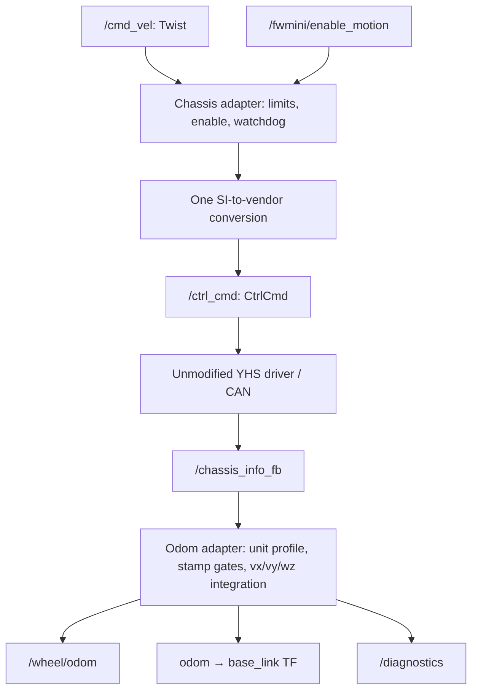

# FW-mini chassis and odometry adapters

ROS 2 Humble / C++17. Existing description, interfaces and bringup packages are unchanged.
Vendor yhs_can_control and yhs_can_interfaces are never edited.

## Data flow



## Topic and service contract

| Endpoint (defaults, topic names configurable) | Type | Unit / meaning |
|---|---|---|
| /cmd_vel | geometry_msgs/Twist | Body-frame vx,vy in m/s; wz in rad/s; other components ignored |
| /ctrl_cmd | yhs_can_interfaces/CtrlCmd | Reviewed vendor ROS API: vx,vy m/s; wz degrees/s |
| /fwmini/enable_motion | std_srvs/SetBool | Starts disabled; enable and disable clear the stored command |
| /chassis_info_fb | yhs_can_interfaces/ChassisInfoFb | Uses only stamped ctrl_fb velocity; not the vendor odom |
| /wheel/odom | nav_msgs/Odometry | odom-frame pose, base_link-frame SI twist |
| /tf | tf2_msgs/TFMessage | Only odom -> base_link; same stamp and pose as odom |
| /diagnostics | diagnostic_msgs/DiagnosticArray | Waiting/timeout ERROR, recent rejected sample/gap WARN, fresh input OK |

New task endpoints /cmd_vel and /wheel/odom supplement the earlier logical project contract.
For a future motion guard, set command_topic=/fwmini/chassis/cmd_vel_guarded.
odom_topic can be set to /fwmini/chassis/odom when that existing project endpoint is needed.

## TF ownership

- fwmini_odom_adapter is the sole odom -> base_link publisher in standalone mode.
- It publishes no map -> odom, no map -> base_link and no static camera transforms.
- map is disconnected until the future localization_manager supplies map -> odom.
- Existing robot_state_publisher owns body/camera fixed edges.
- If a fusion node later owns odom -> base_link, set publish_tf=false in this adapter.
- The reviewed YHS driver publishes an Odometry topic but no TF. Do not feed that Odometry to navigation; remap it aside if necessary.

## Concentrated unit boundary

| Boundary / profile | vx factor | vy factor | wz factor |
|---|---:|---:|---:|
| Command mps + degps (default) | 1 | 1 | 180/pi |
| Command mmps + radps (alternative API only) | 1000 | 1000 | 1 |
| Feedback reviewed_yhs_ros2 (legacy unmodified decoder) | 1 | 0.1 | pi/180 |
| Feedback mps_degps (corrected default) | 1 | 1 | pi/180 |
| Feedback mmps_degps | 0.001 | 0.001 | pi/180 |
| Feedback si | 1 | 1 | 1 |

All command encoding is in chassis core Units::encode; all feedback decoding is in odom core Units::decode.
The reviewed driver already packs m/s into millimetres/s CAN integers. Do NOT select mmps with that driver.
The reviewed_yhs_ros2 profile compensates its confirmed /100 lateral decode where DBC specifies /1000.
It applies ONLY to the reviewed unmodified driver (C++ SHA256 ea636879c99d11619f60256323d7058124007f91c8df3a60bc6aae1280fec6a4).
For corrected vendor code or fake physical values in m/s, choose mps_degps; avoid applying correction twice.

## Command parameters (config/cmd_adapter.yaml)

| Parameter | Default | Meaning |
|---|---|---|
| max_linear_x, max_linear_y | 0.3, 0.3 | Symmetric per-axis limit in m/s, provisional |
| max_angular_z | 0.5 | Symmetric limit in rad/s |
| cmd_timeout | 0.2 | Monotonic reception age in seconds |
| publish_rate | 50.0 | Wall-timer heartbeat Hz, accepted range 10..1000 |
| vendor_linear_unit | mps | mps or mmps at the ROS API boundary |
| vendor_angular_unit | degps | degps or radps at the ROS API boundary |
| control_gear | 0 | Four-bit mode/gear 0..15; actual operational gear remains to be verified |
| command_topic, vendor_command_topic | See contract | Input/output remapping |

Positive finite limits/timeout required. Motion starts disabled. SetBool always clears stored commands.
Enabled output requires a freshly received finite command; NaN/Inf invalidates stored commands.
Watchdog emits zeros at the next 50 Hz timer tick (nominal timeout + up to 20 ms scheduling latency).
Disable publishes a zero immediately. Enable also publishes zero until a fresh command arrives.
The timer republishes commands so the unmodified callback-driven driver sees a periodic heartbeat.
The watchdog is software only: process death / stalled executor / DDS failure requires an independently verified VCU timeout.
No I/O unlock, steering-control mode or free-wheel commands are emitted.

## Odometry parameters (config/odom_adapter.yaml)

| Parameter | Default | Meaning |
|---|---|---|
| feedback_profile | mps_degps | Explicit unit/decoder profile |
| feedback_timeout | 0.2 | Steady reception age and maximum ROS-stamp age in seconds |
| max_dt | 0.2 | Maximum continuous integration interval; must not exceed timeout |
| future_tolerance | 0.05 | Maximum source stamp lead in seconds |
| publish_tf | true | Standalone TF authority toggle |
| feedback_topic, odom_topic | See contract | Input/output remapping |
| pose_variance, twist_variance | YAML six values | Positive diagonal variances in x,y,z,roll,pitch,yaw order |

Frames are fixed to odom / base_link. Manufacturer frame_id is not propagated.
Non-planar pose dimensions are zero; quaternion is normalized; covariances are explicit but provisional.
Source header stamps must be nonzero, fresh and strictly increasing in the current ROS clock epoch.
Use consistent use_sim_time on publishers and adapters for bag replay. Watchdog health still uses a monotonic wall clock.
The first sample establishes a baseline; it does not create displacement.
Euler integration holds the PREVIOUS velocity over the interval:
dx=(vx*cos(yaw)-vy*sin(yaw))*dt; dy=(vx*sin(yaw)+vy*cos(yaw))*dt; dyaw=wz*dt.
Yaw is normalized. There is no vy=0 assumption.
Timeout, rejected samples or a large dt break integration continuity. Recovery retains the last pose and rebaselines.
Unknown displacement during a feedback gap is not reconstructed; diagnostics WARN on recovery.
Backwards ROS clock movement starts a new integration epoch while retaining pose.
Duplicate/out-of-order/NaN/stale/future data do not refresh feedback health.
No new odom or TF is emitted on timeout, and no old pose is restamped as fresh.
Diagnostics run at 20 Hz; configure a navigation monitor to stop motion when feedback is unhealthy.

## Known assumptions and unresolved hardware items

- ctrl_fb expresses BODY velocity about the base_link motion reference; vendor sign, reference point and gear semantics must be confirmed.
- This is planar chassis velocity integration, not four-wheel inverse kinematics or sensor fusion.
- No automatic emergency-stop/remote takeover interlock is claimed: aggregate IoFb subfields lack individual timestamps.
- Encoder slip, slope effects, IMU fusion and covariance calibration are future work.
- Vendor CAN receive/checksum/watchdog/thread bugs listed in vendor_middleware_review.md remain unchanged.
- control_gear=0 is a placeholder; an enabled software service does not prove the chassis is in a valid motion mode.
- Camera extrinsics, AprilTag, Nav2 configuration and map -> odom are outside this change.

## No-hardware verification

```bash
python tools/test_adapter_cores.py
```

This compiles actual C++ cores and tests enable/fresh-command behavior, limits, timeout, signed unit conversion,
non-finite rejection, lateral and rotated-frame integration, non-increasing stamps and gap recovery.
It also checks new package XML and Launch/test Python syntax.

On Ubuntu with ROS 2 Humble and dependencies installed:
```bash
bash tools/test_ros_adapters.sh
```

The script builds untouched vendor INTERFACES as a separate dependency overlay (vendor tests off),
then project packages and adapter tests. No CAN driver is launched.
Install dependencies first using rosdep for src and vendor/yhs_can_interfaces; include launch_testing_ament_cmake and pytest.
ROS launch tests inject Twist and ChassisInfoFb, assert CtrlCmd conversion/limits/enable/watchdog,
and assert odom values, lateral velocity, canonical frames, matching TF stamp/pose, absence of map edge,
and timeout diagnostics/stale rejection. Test topics are isolated; enable service retains the specified absolute name.

## Independent launch / manual fake data

```bash
ros2 launch fwmini_chassis_adapter adapter.launch.py
ros2 launch fwmini_odom_adapter adapter.launch.py
ros2 topic echo /ctrl_cmd
ros2 service call /fwmini/enable_motion std_srvs/srv/SetBool "{data: true}"
ros2 topic pub -r 20 /cmd_vel geometry_msgs/msg/Twist "{linear: {x: 0.1, y: 0.05}, angular: {z: 0.2}}"
```

With no CAN driver, this only tests the ROS command interface. Ctrl-C the fake publisher to observe zeros after timeout.
For fake feedback, use the ROS integration test which generates current header stamps; a CLI message with a zero header is intentionally rejected.

**2026-10-16 corrected vendor driver:** choose `mps_degps` for `/chassis_info_fb`.
The `reviewed_yhs_ros2` profile remains available for the **old unmodified** vendor decoder ONLY. Never multiply lateral feedback by 0.1 after vendor decoding is fixed.
