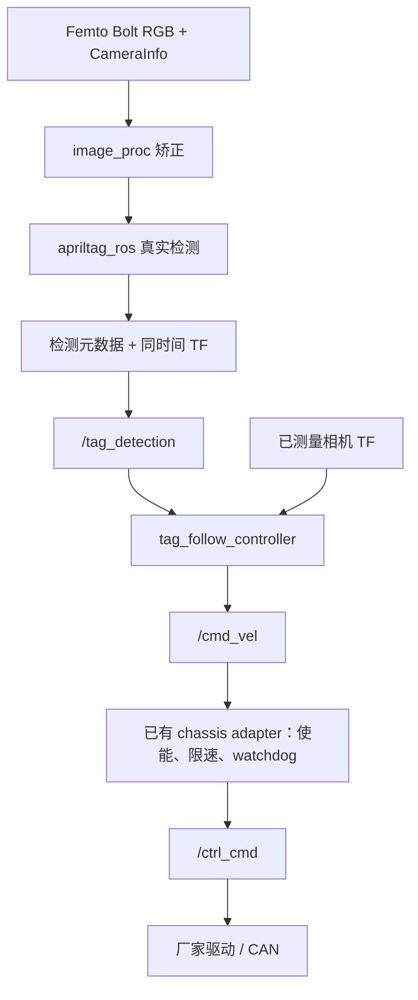

# P1–P4：Femto Bolt → AprilTag → 跟随速度 → FW-mini

本轮增加三个独立包，复用既有 chassis adapter。fwmini_interfaces 仅增加 TagDetection 消息；
fwmini_bringup 仅增加集成 Launch 和依赖。厂家两个包、原有底盘/里程计 adapter、相机外参均未修改。

## 数据流



## 模块与合同

| 包/端点 | 类型或功能 |
|---|---|
| fwmini_perception | 仅封装官方 orbbec_camera/femto_bolt.launch.py |
| /fwmini/camera/color/image_raw | sensor_msgs/Image，厂家 RGB 原始图像 |
| /fwmini/camera/color/camera_info | sensor_msgs/CameraInfo，与图像同时间戳 |
| /fwmini/camera/color/image_rect | image_proc 生成矫正图像 |
| /fwmini/tags/raw_detections | apriltag_msgs/AprilTagDetectionArray |
| /tag_detection | fwmini_interfaces/TagDetection：一个指定目标的 pose/id/family/margin/hamming/valid/reason |
| /fwmini/enable_tag_follow | std_srvs/SetBool，跟随默认关闭 |
| /cmd_vel | geometry_msgs/Twist，底盘坐标系 m/s、rad/s |
| /fwmini/enable_motion | 既有 chassis adapter 的独立开关，默认关闭 |
| /ctrl_cmd | 既有 adapter 输出 yhs_can_interfaces/CtrlCmd |

选择 christianrauch/apriltag_ros 的 ROS2 接口。检测数组本身没有 pose；
位姿由 detector 发布 TF。adapter 使用原始图像时间查询 optical -> fwmini_observed_tag，
允许 TF 晚于检测数组到达，通过非阻塞重试组合。禁止以 latest TF 替代本帧观测。
标签 TF 使用独立名称，不与未来 map -> tag 的测绘静态地标重名。
质量门控：固定目标 ID/族、hamming、decision margin、有效时间戳、前向有限位姿/单位四元数。
多次同 ID 的歧义观测被拒绝。丢目标、低质量、TF 超时以 valid=false 表示；
相机完全断流由 controller 的 source-stamp + steady-clock watchdog 检测。
该 adapter 输出是局部观察，不是 map-frame 全局重定位，也不发布 map -> odom。

## P1 相机边界

启动入口：
```bash
ros2 launch fwmini_perception femto_bolt.launch.py
```

namespace 默认 fwmini，camera_name 默认 camera。camera_name 是合法的节点名；
使用外围 namespace 得到 /fwmini/camera，不能把 fwmini/camera 当作节点名。
提供 serial_number、RGB/depth 开关、分辨率/fps、点云和 publish_tf 参数。
P1 默认 RGB/depth 开启、点云关闭、厂家 TF 关闭，不增加深度处理或外参。
分辨率默认来自官方 launch，实际型号/固件支持必须通过设备验证。
图像 header.frame_id 保留实际厂家 optical frame；当前 Femto Bolt 安装 TF 仍由测量流程补入。
需要厂家内部 TF 时先确认与 robot_state_publisher 的所有权，避免重边。

## P2 检测启动

```bash
ros2 launch apriltag_detector_adapter detector.launch.py tag_size_m:=0.16 target_id:=0
```

0.16 仅是命令示例，必须替换为实际打印黑边尺寸（米）。默认 tag_size_m=0，会拒绝启动，
防止把未知尺寸当作真实标定。相机内参直接使用厂家 CameraInfo；图像先经 image_proc 矫正。
apriltag_ros 使用 rectified CameraInfo 的 P 矩阵。image 与 CameraInfo 必须同时间戳。
质量参数在 config/detector_adapter.yaml；默认 margin=30、hamming=0、观测超时0.2秒均需实验校验。
目标数先限定为1个；该 topic 不是完整多标签地图接口。

## P3 跟随控制

```bash
ros2 launch tag_follow_controller controller.launch.py
```

控制器在原始观测时间将 tag 位置变换到 base_link。相机外参没有被设计或自动估计：
extrinsics_verified=false 时不能启用跟随；设置 true 后仍需要有效的实测 TF。
默认目标距离0.8m、最小0.3m、最大5m；线速度上限0.2m/s、角速度上限0.4rad/s。
距离增益0.4、角度增益1.0；距离死区0.05m、角度死区0.03rad；
偏角超过0.3rad时先转向，暂停前进。首次版本 linear.y=0、禁止倒车。
这是跟随策略的选择，不改变 chassis/odom adapter 支持完整 vy 的能力。
目标在身后、过近/过远、消息无效、TF 缺失/过期或标签0.2秒超时均输出零速度。
发布频率20Hz；厂家命令由既有 chassis adapter 以50Hz重复发布。
参数是启动参数；修改 YAML 后重启模块，未实现动态增益更新。

## P4 集成入口

```bash
ros2 launch fwmini_bringup tag_follow.launch.py tag_size_m:=实际尺寸 target_id:=0
```

集成入口启动相机、矫正、检测、adapter、controller 和 chassis adapter。
不伪造安装 TF，不自动启动厂家 CAN 驱动，不自动开启任何运动。
相机外参测量且 TF 验证后，可传 extrinsics_verified:=true；
随后分别调用 enable_tag_follow 和 enable_motion，且需要新观测/新命令。
本轮继续保留本地 commit，不推送远程。

实车连接流程：
1. 先检查 camera 图像/内参和 /tag_detection，不启用运动。
2. 填入实测安装 TF，核对右侧目标转向负z、左侧正z。
3. 确认厂家 control_gear、急停、遥控接管和 VCU 失联停车。
4. 单独启动厂家 yhs_can_control；只让既有 adapter 发布 /ctrl_cmd。
5. 在底盘架起、低速受控条件下启用跟随和运动，检查丢标签/停相机/停控制器归零。
6. 记录 rosbag 并评估实际跟随误差。

当前没有避障、路径规划或 Nav2 介入。此模式的 /cmd_vel 不能与 Nav2 同时直接发布；
未来需要 mux/任务状态选择唯一速度源。地形、碰撞检测和安全停机不是该示例控制器的能力。

## 无硬件测试

```bash
python tools/test_tag_follow_cores.py
bash tools/test_tag_follow_ros.sh
```

第一个命令实际编译执行质量门控、跟随算法和核心链路测试。
第二个命令需要 Ubuntu22.04/Humble 与依赖，启动真实 image_proc 和 apriltag_ros，
注入官方 tag36h11 ID0 的合成 Image + CameraInfo。测试使用独立 /p4 topic 和测试专用静态相机 TF：
检查有效 tag、方向/距离、使能前归零、正向速度和负角速度、白画面丢标签、
相机断流归零和手动关闭跟随。输出只到 /p4/ctrl_cmd，绝不启动 CAN 驱动。
合成图像和0.16m尺寸、测试 TF 不代表真实相机标定。
运行测试时使用空闲 ROS_DOMAIN_ID，避免外部节点的同名 service/TF 干扰。

## 依赖与核对的上游资源

先安装/构建官方 OrbbecSDK_ROS2，确保 orbbec_camera 可见；
安装 Humble 的 apriltag_ros/apriltag_msgs、image_proc、launch_testing_ament_cmake/rclpy/pytest。
厂家 yhs_can_interfaces 由测试脚本作为独立 overlay 编译，源码保持不动。
依赖不足会明确阻断 ROS 验证；独立核心 PASS 不代表相机或完整 ROS 链路 PASS。

- Orbbec v2-main 官方 launch：
  https://github.com/orbbec/OrbbecSDK_ROS2/blob/v2-main/orbbec_camera/launch/femto_bolt.launch.py
  inspected blob: 5854ec664d3afb54522a9b48adb42cbd9059f2cc
- AprilTag detector source:
  https://github.com/christianrauch/apriltag_ros/blob/master/src/AprilTagNode.cpp
  inspected blob: b40d800c5b386185a672afe98380b4ca5d819035
- Detection schema:
  https://github.com/christianrauch/apriltag_msgs/blob/master/msg/AprilTagDetection.msg
- Humble image_proc executable confirmed in its CMake:
  https://github.com/ros-perception/image_pipeline/blob/humble/image_proc/CMakeLists.txt
- Synthetic fixture source:
  https://github.com/AprilRobotics/apriltag-imgs/blob/master/tag36h11/tag36_11_00000.png
  inspected blob: be526dd7282c962d26747cd1fca50e2116a942ee

以上是本轮核对的接口快照，不表示已经将用户电脑上的依赖锁定到这些版本。
